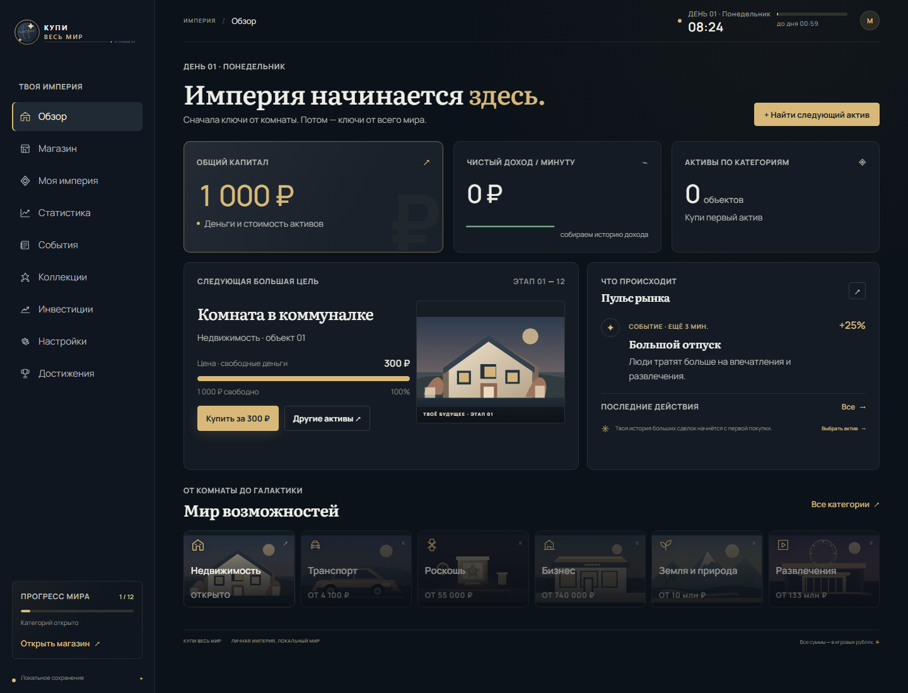
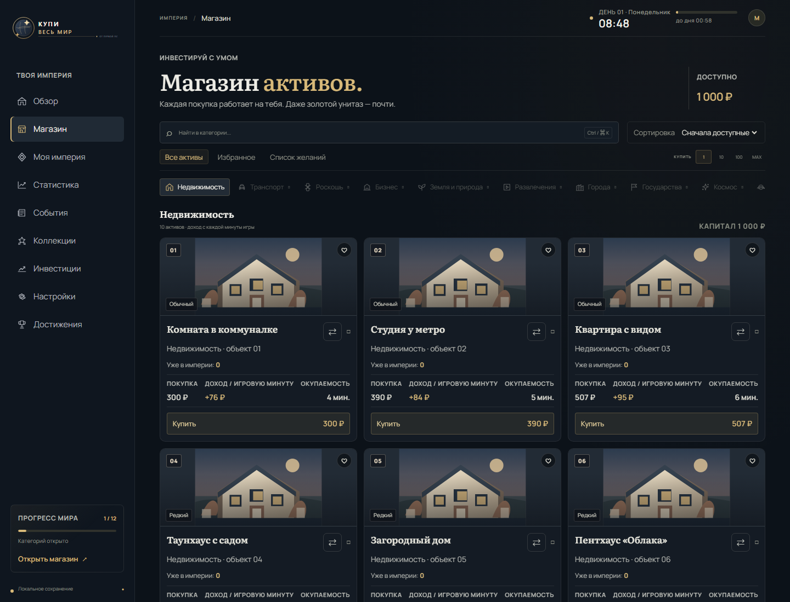
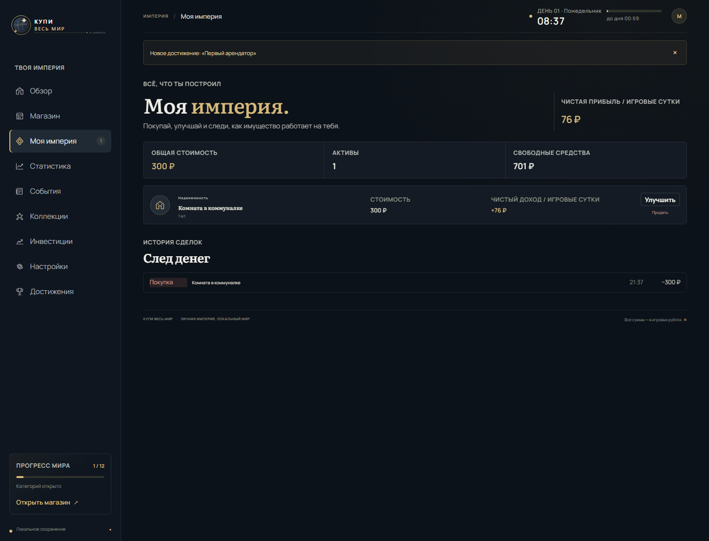

<div align="center">

# Купи весь мир

### От первой комнаты до собственной галактики

Покупай активы, получай доход, переживай рыночные события и строй империю — прямо в браузере.

**Локальная одиночная tycoon-игра на русском языке.**

[Игровой обзор](#игровой-цикл) · [Скриншоты](#скриншоты) · [Запуск](#запуск) · [Технологии](#технологии)

[Играть онлайн](https://smirty8181.github.io/Buy-the-World/)

</div>

---

Начни с **1 000 игровых рублей** и первой комнаты. Покупки приносят доход, новые активы открывают категории, а решения постепенно превращают небольшое хозяйство в целую империю. Можно играть в своём темпе: прогресс хранится в браузере и остаётся на устройстве.

## Игровой цикл

1. **Выбери актив.** Сравни цену, доход, расходы, редкость и срок окупаемости.
2. **Расширяй владения.** Покупай объекты по одному или используй пакетную покупку.
3. **Увеличивай прибыль.** Улучшай активы и собирай тематические коллекции.
4. **Следи за рынком.** Временные события меняют доходность категорий; стоимость фондов меняется каждый игровой день.
5. **Открывай новые горизонты.** По мере роста капитала становятся доступны всё новые категории — вплоть до космоса.

## Что внутри

- **12 категорий и 120 активов** — недвижимость, транспорт, бизнес, развлечения, космос и другие ступени роста.
- **Сцены не повторяются карточка в карточку:** у категорий свой сюжет, а у объектов — отдельное кадрирование, цветовая обработка, подпись и тематическая пиктограмма.
- **Понятная экономика:** игровой день длится одну минуту; у активов есть цена, доход, расходы и окупаемость.
- **Управление портфелем:** покупка нескольких объектов, продажа за 80% стоимости и улучшения до пятого уровня.
- **Живой рынок:** кризисы, сезонный спрос и другие события меняют доходность.
- **Инвестиции:** три вымышленных фонда с меняющейся стоимостью долей; их цена учитывается в общем капитале.
- **Коллекции и достижения:** собирай тематические наборы и отмечай игровые цели.
- **История и аналитика:** графики капитала и дохода, календарь и журнал сделок.
- **Личные настройки:** три цветовые темы, компактный каталог, избранное и список желаний.
- **Локальный прогресс:** сохранения остаются в браузере; офлайн-начисление ограничено 12 часами.
- **Аккуратная работа с сохранениями:** формат данных обновляется между версиями, а повреждённая копия сохраняется перед восстановлением.

## Скриншоты

### Обзор империи



### Магазин активов



### Моя империя



Все деньги и фонды в игре виртуальные. Проект не подключается к платёжным системам, не принимает настоящие деньги и не предоставляет финансовых услуг.

## Запуск

Нужны Node.js 22 или новее и npm.

```bash
npm install
npm run dev
```

Для production-сборки:

```bash
npm run build
npm run preview
```

## Проверки

```bash
npm test
npm run lint
npm run build
```

Тесты покрывают каталог, игровую экономику, валюты, сохранение прогресса и игровое состояние.

## Технологии

| Часть | Технологии |
|---|---|
| Интерфейс | Vue 3, TypeScript |
| Состояние игры | Pinia |
| Сборка | Vite |
| Тесты | Vitest |
| Качество кода | ESLint |
| Иллюстрации | Авторские SVG-сцены и иконки |

---

**«Купи весь мир» — демонстрационная учебная работа.** Игровые цены, фонды, события и доходность придуманы для игрового процесса и не являются инвестиционной рекомендацией.
